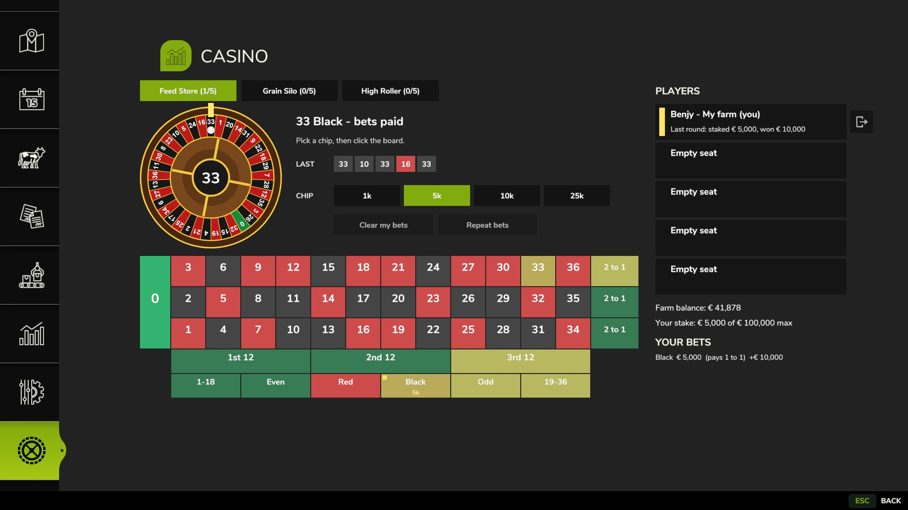

# FS25 Casino

A Farming Simulator 25 mod that adds a **Casino** page to the in-game menu with three virtual roulette tables
(European, single zero). Players at a table see each other's bets live. Works in single player, hosted and
dedicated multiplayer.



## Install

Download `FS25_Casino.zip` from the [latest release](https://github.com/Benjythebee/FS25_Casino/releases/latest)
(or build it with `tools/package.ps1`), put it in
`Documents\My Games\FarmingSimulator2025\mods` and enable **Casino** when starting a savegame. In multiplayer the host
and every player need the same zip.

## Rules of the mod

- 3 tables, 5 seats each. Anyone can open the page and watch; only a farm's **farm manager** can take a seat and bet.
  In single player you are always the manager.
- One seat per player across all tables.
- **The game is the house.** Stakes are reserved when placed and charged when the ball lands, together with the
  winnings, as "Casino bets" / "Casino winnings" in the farm's finances. Quitting mid-round costs nothing.
- Round: 25 s betting, 7 s spin, 6 s result. Empty rounds restart the timer; the table closes when everyone leaves.
- Leaving during betting drops your bets; leaving during a spin keeps them and still pays your farm.

| Table | Chips | Max stake per seat and round |
|---|---|---|
| Feed Store | 1k, 5k, 10k, 25k | 100,000 |
| Grain Silo | 10k, 50k, 100k, 250k | 1,000,000 |
| High Roller | 100k, 250k, 500k, 1M | 5,000,000 |

Bets on the page: single numbers (35:1), dozens and columns (2:1), red/black, odd/even, 1-18/19-36 (1:1). The rules
and the server also accept split, street, corner and six line bets (`RouletteRules.KIND`); the page just doesn't
offer them yet. Edit `Casino.TABLES` in `scripts/Casino.lua` to change tables.

Click an empty seat in the Players list to sit down; the door button next to your seat leaves the table. The wheel
is two rotating textures (wheel and ball): every client computes the same angles from the shared round timer, so the
ball lands on the server's result under the gold pointer, and the hub shows the last number.

## Layout

```
FS25_Casino/                 the mod (ships as FS25_Casino.zip)
  modDesc.xml
  icon_casino.dds            512x512 mod icon
  images/menuIcon.dds        menu tab icon (white glyph, tinted by the game)
  images/wheel.dds, ball.dds the rotating wheel and ball layers
  images/leave.dds           leave-seat icon
  scripts/Casino.lua         bootstrap, server request handling, money, menu page registration
  scripts/RouletteRules.lua  pure rules: wheel, bets, payouts (no game dependencies)
  scripts/RouletteTable.lua  one table: seats, bets, round state machine, network serialisation
  scripts/events/            CasinoSeatEvent, CasinoBetEvent (client -> server),
                             CasinoTableStateEvent, CasinoMessageEvent, CasinoNotifyEvent (server -> client)
  scripts/gui/CasinoFrame.lua the menu page controller
  gui/CasinoFrame.xml        page layout, GENERATED by tools/gen_frame.py
  gui/guiProfiles.xml        colours and text styles
  l10n/l10n_en.xml, _de, _fr
tools/
  gen_frame.py               regenerates gui/CasinoFrame.xml
  make_icons.py              regenerates all DDS textures (Pillow, numpy)
  dds.py                     BC1/BC3 (DXT1/DXT5) DDS encoder used by make_icons.py
  check_l10n.py              XML parses, en/de/fr keys and placeholders match, entries capitalised
  preview_layout.py          draws the layout to tools/layout_preview.png
  check_lua.mjs, run_tests.mjs, tests.lua, test_stubs.lua   offline checks (npm i, then npm run check)
  install.ps1                links the mod into Documents\My Games\FarmingSimulator2025\mods
  package.ps1                builds dist\FS25_Casino.zip
```

## Networking

The server owns the tables. A client click sends a request event; the server checks the seat, farm manager status,
chip value, table limit and the farm's available money (balance minus stakes reserved on all tables), then
broadcasts the whole table state. Results come from the server's random generator, so every player sees the same
spin: clients animate the wheel strip from the shared timer. Joining players receive all tables in
`sendInitialClientState`.

HUD notifications (`CasinoNotifyEvent`): when betting closes every *other* player sees "Casino: Anna bet €15,000 at
Feed Store"; when the ball lands each player gets their own "you bet X and won Y / did not win". The server sends a
result only to the player it belongs to, so winnings never reach other clients.

The random generator was checked with game-like timing: uniform over the 37 pockets and no repeat pattern after
1-4 spins (tests.lua).

## Testing

```
cd tools
npm i
npm run check
```

In game: run `tools/install.ps1`, start a savegame with the mod enabled, open the menu and go to the Casino tab.
Script errors land in `Documents\My Games\FarmingSimulator2025\log.txt` (search for `Casino`).

Multiplayer only accepts zipped mods: run `tools/package.ps1` and put `dist\FS25_Casino.zip` in the mods folder of the
host and every player (remove the linked `FS25_Casino` folder first, the two would clash).

Publishing on ModHub: see [docs/modhub/SUBMISSION.md](docs/modhub/SUBMISSION.md).

## License

MIT, see [LICENSE](LICENSE). Farming Simulator is a trademark of GIANTS Software; this is an unofficial fan mod.

## Ideas

- Blackjack on the same seat/round/event framework (the server only sends each player their own cards).
- A physical bar placeable whose table opens this page.
